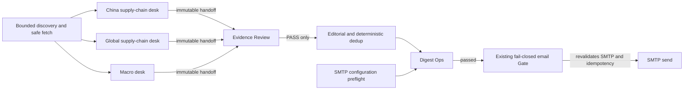

# AI Intelligence Monitor architecture

## Frozen core and additive Phase 3C boundary

The Phase 0–2 DRAM/HBM Harness, Evidence, State Machine, Signal,
Adjudication, Replay, and Ops modules remain frozen. Phase 3C is an additive
daily-digest channel and does not import its department state into the frozen
core. Department communication is through versioned, write-once JSON artifacts
under one run directory.

## Department contract

Each content desk has its own supplemental prompt, candidate list, request
budget, provider-usage record, failures, Evidence decisions, Ops result, frozen
fixture, replay path, and handoff. All desks share the unchanged
`daily_global_ai_analysis_v9.txt` base instruction and the same
`GlobalAiAnalysisContract`; a department prompt can narrow scope but cannot
weaken Evidence, importance, neutrality, or market-action rules.

The orchestrator currently routes by source domain: official macro domains,
then `.cn`/registered China domains, then global. This is a bounded heuristic,
not entity recognition. Final digest region labels are validated analysis
fields; routing and final region are not equivalent. The intended scopes are:

- `china`: events determined by actors, assets, policy jurisdiction, or directly
  affected Chinese supply chains—not by article language alone.
- `global`: non-China AI industrial-chain events.
- `macro`: bounded official U.S. Treasury/Federal Reserve events with direct
  financing, liquidity, capex, or risk transmission relevance.

Downstream stages are:

- `evidence-review`: deterministic exact-quote and URL review. It cannot rewrite
  an analysis.
- `editorial`: consumes Evidence-PASS records only and applies existing
  deterministic deduplication, threshold, sector-cap, and total-limit rules.
- `delivery`: combines department completion, Editorial/Digest Ops, render,
  idempotency, and a secret-scoped SMTP configuration preflight. The existing
  email adapter repeats SMTP validation before connecting.

These are three model-backed content desks plus deterministic downstream
stages, not six autonomous LLM agents. Downstream prompt/version files document
contracts; Evidence Review, Editorial and Delivery do not make LLM calls.

Statuses are `PENDING`, `RUNNING`, `HEALTHY`, `HEALTHY_EMPTY`, `DEGRADED`,
`FAILED`, and `BLOCKED`. A necessary desk that is halted, has unprocessed
candidates, or records a provider-level timeout/network/quota/configuration
failure that remains unresolved is not healthy. Recovered failures remain in
`provider-request-events.json` without automatically degrading a completed desk.
`HEALTHY_EMPTY` means the desk completed normally and
found no publishable item; it never means a provider failure was hidden.

## Artifacts and replay

Every run writes `departments/<department>/` with:

- `input.json`
- `discovery.json`
- `fetch.json`
- `analysis.json`
- `evidence.json`
- `ops.json`
- `provider-usage.json`
- `handoff.json`

`department-manifest.json` records the handoff path and SHA-256 for all six
departments. Files are created with write-once semantics. Department replay
validates selected contract-bearing files and copies frozen JSON, recording `network_calls=0` and
`llm_calls=0`; it never calls discovery, Gemini, or SMTP.
It records the source handoff hash but does not currently verify every embedded
artifact hash. Replay success is not a complete integrity or semantic re-audit.

## Gemini quota transition

`GEMINI_ANALYSIS_MODEL` is the primary model. A lower model is eligible only
when `GEMINI_FALLBACK_MODEL` is configured. The daily-quota path additionally
requires `GEMINI_QUOTA_FALLBACK_ENABLED=true`. The persistent-503 path is a
separate opt-in, `GEMINI_SERVER_FALLBACK_ENABLED=true`, and is considered only
after ordinary retries plus the one shared server-recovery cooldown fail. The
shared controller permits only one model transition. It never switches on an
ordinary rate limit, timeout, non-503 server error, content failure, or schema
failure, and never changes provider. There is no automatic paid-model selection;
operators must verify configured models' current quota/billing eligibility
separately.

The request governor remains shared across departments while each desk keeps an
independent logical budget. Models actually used and the transition reason
(`GEMINI_DAILY_QUOTA_FALLBACK` or `GEMINI_SERVER_ERROR_FALLBACK`) are written to
provider usage, Ops audit, source bundle, summary, plain-text digest, and HTML
email. If the fallback also fails or any required desk remains incomplete, Ops
blocks publication and email.

The scheduled limits are 50 fetched candidates and 65 HTTP requests including
retries and transition calls (CLI hard ceiling 80). Department allocations share
that total and the governor's runtime deadline. Reserve capacity does not guarantee
completion. A request budget cannot shrink the coverage denominator or relax gates.

## Publication and delivery boundary

Phase 3C admission and final Ops share deterministic narrative-language and
text-quality checks. Invalid individual outputs are audited and excluded before
selection, without modifying facts or Evidence. A desk whose schema-valid outputs
all fail language checks is blocked, not a healthy empty digest. Unexpected
execution errors and any unprocessed candidates also block delivery. Optional
empty risk/path fields and original-language quotes remain legal.

Provider transport/structure health is measured per content desk: at least 80%
of attempted candidates must produce schema-validated responses. This permits
isolated, audited terminal network/5xx failures without turning one article into
a whole-digest outage, while low response coverage still fails closed. Content
rejections remain governed independently by Evidence, language and discipline gates.

The shared Phase 3C `ops_report.py` predicate requires Boolean `passed=true`,
Boolean `true` for every supplied check, and an empty supplied error list at both
publication and mail boundaries. Email reads exactly one `ops.json` block inside
the internal audit appendix, never a lookalike in reader content. The appendix
is excluded from mail.

Both sending workflows share one concurrency group. Manual delivery selects an
ISO date (default: today in Asia/Shanghai), never substituting yesterday's digest.
A same-day unresolved `PENDING`/`UNKNOWN` ledger attempt blocks resending, including
after content regeneration. Failure handling attempts to commit only the ledger,
not a failed digest. Cancellation, runner loss or Git push failure can still lose
an uncommitted record: this is not an exactly-once delivery guarantee. See the
[operator runbook](docs/PHASE_3C_RUNBOOK.md).

## Credential boundary

Gemini keys are header-only. SMTP and provider credentials remain in ignored
local environment files or GitHub Secrets. The SMTP preflight runs in a
separate workflow step with no network and exports only `true` or `false` to the
analysis process. API keys, SMTP recipient addresses, authentication headers,
passwords and raw provider error bodies are excluded from audit output. Safe
source text is intentionally retained as Evidence in run artifacts and may itself
contain public contact information; that is distinct from SMTP credentials.
The Git send ledger retains delivery metadata, not recipient addresses.
