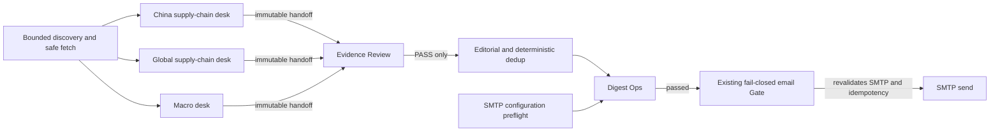

# AI Intelligence Monitor architecture

## Frozen core and additive Phase 3C boundary

The Phase 0–2 DRAM/HBM Harness, Evidence, State Machine, Signal,
Adjudication, Replay, and Ops modules remain frozen. Phase 3C is an additive
daily-digest channel and does not import its department state into the frozen
core. Department communication is through versioned, write-once JSON artifacts
under one run directory.

## Department contract

Each content desk has its own supplemental prompt, candidate list, request
budget, provider-usage record, failures, Evidence decisions, Ops result, frozen
fixture, replay path, and handoff. All desks share the unchanged
`daily_global_ai_analysis_v9.txt` base instruction and the same
`GlobalAiAnalysisContract`; a department prompt can narrow scope but cannot
weaken Evidence, importance, neutrality, or market-action rules.

The content desks are:

- `china`: events determined by actors, assets, policy jurisdiction, or directly
  affected Chinese supply chains—not by article language alone.
- `global`: non-China AI industrial-chain events.
- `macro`: bounded official U.S. Treasury/Federal Reserve events with direct
  financing, liquidity, capex, or risk transmission relevance.

Downstream stages are:

- `evidence-review`: deterministic exact-quote and URL review. It cannot rewrite
  an analysis.
- `editorial`: consumes Evidence-PASS records only and applies existing
  deterministic deduplication, threshold, sector-cap, and total-limit rules.
- `delivery`: combines department completion, Editorial/Digest Ops, render,
  idempotency, and a secret-scoped SMTP configuration preflight. The existing
  email adapter repeats SMTP validation before connecting.

Statuses are `PENDING`, `RUNNING`, `HEALTHY`, `HEALTHY_EMPTY`, `DEGRADED`,
`FAILED`, and `BLOCKED`. A necessary desk that is halted, has unprocessed
candidates, or records a provider-level timeout/network/quota/configuration
failure is not healthy. `HEALTHY_EMPTY` means the desk completed normally and
found no publishable item; it never means a provider failure was hidden.

## Artifacts and replay

Every run writes `departments/<department>/` with:

- `input.json`
- `discovery.json`
- `fetch.json`
- `analysis.json`
- `evidence.json`
- `ops.json`
- `provider-usage.json`
- `handoff.json`

`department-manifest.json` records the handoff path and SHA-256 for all six
departments. Files are created with write-once semantics. Department replay
validates and copies frozen JSON only and records `network_calls=0` and
`llm_calls=0`; it never calls discovery, Gemini, or SMTP.

## Gemini quota transition

`GEMINI_ANALYSIS_MODEL` is the primary model. A lower model is eligible only
when both `GEMINI_FALLBACK_MODEL` is configured and
`GEMINI_QUOTA_FALLBACK_ENABLED=true`. The shared controller permits one switch
only for an explicit per-model daily-quota response. It never switches on an
ordinary rate limit, timeout, server error, content failure, or schema failure,
and never changes provider or selects a paid model.

The request governor remains shared across departments while each desk keeps an
independent logical budget. Models actually used and the transition reason are
written to provider usage, Ops audit, source bundle, summary, plain-text digest,
and HTML email. If the fallback also fails or any required desk remains
incomplete, Ops blocks publication and email.

## Credential boundary

Gemini keys are header-only. SMTP and provider credentials remain in ignored
local environment files or GitHub Secrets. The SMTP preflight runs in a
separate workflow step with no network and exports only `true` or `false` to the
analysis process. Keys, addresses, raw headers, provider bodies, and passwords
are not written to Git, artifacts, logs, or the database.
